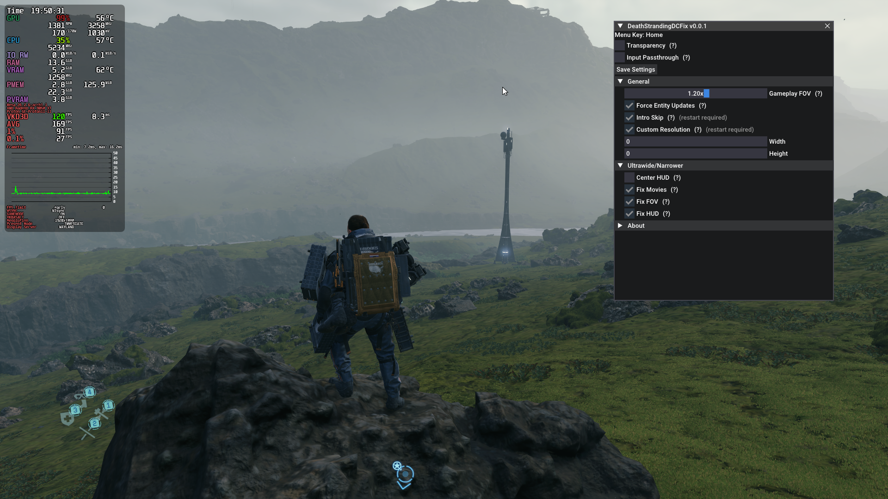

# DeathStrandingDCFix

**DeathStrandingDCFix** is a drop-in `winhttp.dll` mod for **Death Stranding: Director's Cut** that expands ultrawide support, fixes camera stutter, skips intro logos and more.

## Features

### General

- Skip intro logos.
- Custom resolutions.
- Fixed camera stutter over 60fps.
- Adjustable gameplay FOV.

### Ultrawide/Narrower

- Expanded ultrawide support.
- Correctly scaled pre-rendered videos.
- Support for narrower than 16:9 aspect ratios.
- Centered 16:9 gameplay HUD (ultrawide-only).

## Installation  

- Download the latest [release](../../../releases).
- Extract the contents of the release zip in to the the game folder. (e.g. **steamapps\common\DEATH STRANDING DIRECTORS CUT** for Steam)
- Updating from an older version: delete `DeathStrandingDCFix.asi`, the fix is now `winhttp.dll` itself and no longer needs Ultimate ASI Loader.

### Steam Deck/Linux Additional Instructions

🚩**You do not need to do this if you are using Windows!**  

- Open up the game properties in your launcher and add `WINEDLLOVERRIDES="winhttp=n,b" %command%` to the launch options.

## Configuration

- Press **Home** in-game to open the settings menu. Most settings apply instantly; click **Save Settings** to write them to the ini.
- Or open **`DeathStrandingDCFix.ini`** to adjust settings.

## Building from source

- **Windows:** `cmake -S . -B build/windows -A x64 && cmake --build build/windows --config MinSizeRel` (Visual Studio 2022 + CMake 3.28+).
- **Linux:** `make` (CMake + MinGW-w64 cross-compile). See [Building on Arch Linux](wiki/Building-on-Arch-Linux.md).
- Third-party libraries are downloaded by CMake on the first configure. Their versions are pinned in [`cmake/Dependencies.cmake`](cmake/Dependencies.cmake).

## Known Issues

- Mouse input is offset at <16:9 when **[Fix HUD]** is enabled.

## Screenshots

|  |
|:--------------------------:|
| In-game settings menu (**Home**) |
|  |
| Gameplay |

## Credits

Thanks to **Hotiraipha** for commissioning this fix!  
[REFramework](https://github.com/praydog/REFramework) for the menu style and the overlay-friendly D3D12 hooking approach.  
[inipp](https://github.com/mcmtroffaes/inipp) for ini reading.  
[spdlog](https://github.com/gabime/spdlog) for logging.  
[safetyhook](https://github.com/cursey/safetyhook) for hooking.  
[Dear ImGui](https://github.com/ocornut/imgui) for the in-game menu.
