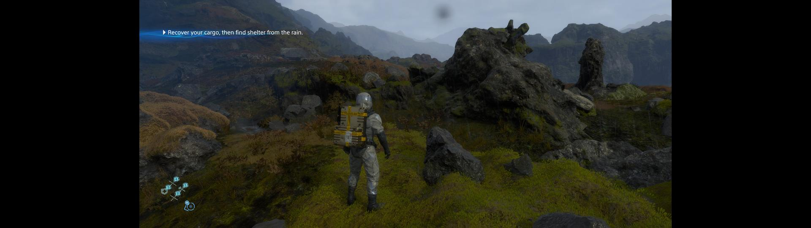

# DeathStrandingDCFix

 

**DeathStrandingDCFix** is an ASI plugin for **Death Stranding: Director's Cut** that expands ultrawide support, fixes camera stutter, skips intro logos and more.

## Features

### General

- Skip intro logos.
- Custom resolutions.
- Fixed camera stutter over 60fps.
- Adjustable gameplay FOV.

### Ultrawide/Narrower

- Expanded ultrawide support.
- Correctly scaled pre-rendered videos.
- Support for narrower than 16:9 aspect ratios.
- Centered 16:9 gameplay HUD (ultrawide-only).

## Installation  

- Download the latest [release](../../../releases).
- Extract the contents of the release zip in to the the game folder. (e.g. **steamapps\common\DEATH STRANDING DIRECTORS CUT** for Steam)

### Steam Deck/Linux Additional Instructions

🚩**You do not need to do this if you are using Windows!**  

- Open up the game properties in your launcher and add `WINEDLLOVERRIDES="winhttp=n,b" %command%` to the launch options.

## Configuration

- Open **`DeathStrandingDCFix.ini`** to adjust settings.

## Building from source

- **Windows:** `xmake f -p windows -a x64 -m release && xmake build`
- **Linux:** `make` (CMake + MinGW-w64 cross-compile). See [Building on Arch Linux](wiki/Building-on-Arch-Linux.md).

## Known Issues

- Mouse input is offset at <16:9 when **[Fix HUD]** is enabled.

## Screenshots

|  |
|:--------------------------:|
| Gameplay |

## Credits

Thanks to **Hotiraipha** for commissioning this fix!  
[Ultimate ASI Loader](https://github.com/ThirteenAG/Ultimate-ASI-Loader) for ASI loading.  
[inipp](https://github.com/mcmtroffaes/inipp) for ini reading.  
[spdlog](https://github.com/gabime/spdlog) for logging.  
[safetyhook](https://github.com/cursey/safetyhook) for hooking.
